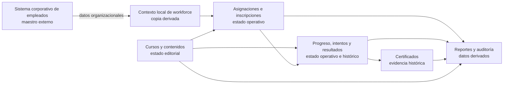

# Semana 6. Mapa de datos y workloads de SkillHub

## 1. Principios de ownership

Cada grupo tiene una única fuente maestra. Puede haber réplicas, cachés o proyecciones, pero son copias derivadas y no pueden aceptar escrituras independientes que contradigan al propietario.

- **M-01 Gobierno de cursos y catálogo** posee la definición editorial de cursos y contenidos.
- **M-02 Asignaciones e inscripciones** posee las relaciones de obligación o inscripción.
- **M-03 Aprendizaje y evaluación** posee progreso, intentos y resultados.
- **M-04 Certificación y evidencia** posee certificados.
- **Sistema corporativo de empleados** posee los datos maestros organizacionales.
- **M-07 Reportes y auditoría** posee agregados y hechos de auditoría derivados, no los estados operativos originales.

Los datos actuales representan el estado que gobierna una operación. Los datos históricos conservan lo que ocurrió y no deben reescribirse para reflejar una situación posterior. Los datos derivados se pueden reconstruir desde sus fuentes y deben conservar su fecha de corte y procedencia.

## 2. Mapa de datos

El flujo va desde fuentes maestras hacia estados operativos y después hacia evidencia y reportes. Reportes no devuelve cambios a cursos, asignaciones, resultados o certificados. La representación local de workforce permite identificar y autorizar, pero no sustituye al sistema externo.

## 3. Grupos, workloads y garantías

| Grupo de datos | Propietario y consumidores | Ciclo de vida | Workload y consistencia | Transacciones relevantes | Replicación, caché o pipeline | Fuente no disponible |
|---|---|---|---|---|---|---|
| **Cursos y contenidos** | M-01. Consumen instructores, RR. HH., catálogo, asignaciones, aprendizaje y reportes. | Borrador -> revisión -> publicado -> retirado/archivado. El contenido publicado debe conservar la referencia usada por el aprendizaje. Correcciones posteriores requieren una política explícita; no se sobrescribe evidencia histórica sin trazabilidad. | Principalmente OLTP para edición, revisión y publicación; lecturas repetidas de catálogo y contenidos. Consistencia fuerte para transiciones y visibilidad: un curso devuelto no puede seguir apareciendo como publicado. | Enviar a revisión debe validar mínimos y cambiar el estado completo; aprobar/publicar debe ser una transición única y auditable. | Datos estructurados y relaciones claras justifican almacenamiento relacional inicial. Caché-aside del catálogo o contenido público puede ser aceptable con TTL corto porque una demora breve no autoriza operaciones; debe invalidarse al publicar o retirar. No se necesita NoSQL ni pipeline para el MVP. | No se puede publicar ni modificar el estado editorial. Se pueden consultar borradores locales y cursos ya publicados según su última confirmación, claramente como estado conocido; no se debe confirmar una nueva publicación. |
| **Asignaciones y progreso** | M-02 posee asignaciones e inscripciones; M-03 posee progreso. Consumen empleados, cursos, empleados finales, RR. HH. y reportes. No se mezclan las dos fuentes maestras aunque se consulten juntas. | La asignación pasa por pendiente de validación, activa, en progreso, completada, vencida o cancelada según reglas. El progreso crece durante el curso y puede cerrarse al completar. La obligación y el avance histórico deben conservar sus fechas. | OLTP de lecturas y escrituras pequeñas, con picos durante campañas. Consistencia fuerte para evitar asignaciones activas duplicadas y para impedir completar sin contenidos obligatorios; un reporte de progreso puede tolerar retraso. | Activar una asignación requiere validación de empleado y deduplicación por empleado-curso-campaña. Registrar avance debe ser idempotente para una misma evidencia. La transición a completado debe coordinar progreso obligatorio y resultado aprobado. | Relacional por relaciones, restricciones y transiciones. No cachear estado de autorización ni límite de completitud; una vista de “mi plan” podría cachearse solo con invalidación o TTL corto. No replicar escrituras. Un pipeline de eventos hacia reportes se justifica para proteger OLTP frente a consultas analíticas. | Nuevas asignaciones dependientes de empleados quedan pendientes. El usuario puede consultar asignaciones y progreso ya confirmados, pero no se inventan cambios ni se aceptan avances que requieran una regla no verificable. |
| **Intentos y resultados** | M-03. Consumen empleado, curso, asignación, evaluación, RR. HH. autorizado y reportes. | Cada intento es histórico e inmutable después de registrarse, salvo corrección auditada. El resultado actual puede resumir el último estado, pero debe poder reconstruirse desde intentos. La eliminación depende de retención legal y no debe borrar la evidencia antes de tiempo. | OLTP con escrituras pequeñas y posibles concurrencias; consistencia fuerte para calificación mínima, máximo de intentos y desbloqueos. No se acepta consistencia eventual al decidir si queda otro intento. | Registrar intento, comprobar cupo, calcular resultado y actualizar estado de aprendizaje deben preservar el invariante de no superar el límite. Un desbloqueo aprobado debe ser visible antes de aceptar un nuevo intento. | Relacional por integridad y transacciones cortas. No usar caché para contar intentos o autorizar evaluaciones. Replicación de lectura solo para consultas no críticas y siempre identificada como no apta para decidir; pipeline de hechos hacia reportes de forma asíncrona. | No aceptar nuevos intentos ni presentar una decisión final si no puede verificarse el límite. Puede mostrarse el último resultado confirmado y permitir que el empleado vuelva a intentar después. |
| **Certificados** | M-04. Consumen la finalización de M-03; los consultan empleados y RR. HH.; Comunicación notifica y Reportes agrega. | Emitido -> vigente -> vencido o revocado según política. Es evidencia histórica: no debe regenerarse con datos distintos sin conservar relación con la emisión original. Correcciones deben producir una acción auditable y no borrar silenciosamente el documento anterior. | OLTP para emisión y consulta; descargas de documentos. Consistencia fuerte e idempotencia para no emitir dos certificados por la misma finalización. Las consultas de reportes pueden ser derivadas. | Una finalización elegible debe crear como máximo un certificado para la misma política y versión de curso. Repetir el evento de finalización debe devolver o reconocer el certificado existente. | Relacional para identidad, vigencia y unicidad; almacenamiento de documentos separado conceptualmente para el contenido binario, sin elegir tecnología. Puede existir una réplica de lectura o copia de recuperación, pero no otra fuente de emisión. No cachear permisos ni vigencia sin invalidación. | Se conserva la finalización y la solicitud de emisión pendiente; no se marca como certificado entregado si el documento no quedó confirmado. El empleado puede ver el estado pendiente y los certificados ya emitidos. |
| **Datos de empleados** | El sistema corporativo posee nombre, área, rol y estado activo. M-05 mantiene una representación local derivada para autorización, asignaciones y reportes; no la puede editar como fuente maestra. | Alta, cambios organizacionales, inactivación y eventual eliminación según política corporativa. La representación local debe registrar momento de sincronización, estado de frescura y origen. Los cambios históricos usados en reportes deben conservar contexto temporal o una referencia a la versión observada. | Consulta OLTP externa para validar elegibilidad y autorización; reportes usan una copia derivada. Consistencia fuerte o frescura garantizada para activar asignaciones y autorizar datos sensibles; eventual es aceptable para una vista informativa o un reporte no crítico, con fecha de corte. | Validar empleado y criterio, luego activar una asignación solo si la respuesta es positiva y vigente. No hay transacción que escriba en el sistema maestro desde SkillHub. | Una copia local es necesaria para reducir dependencia en lecturas repetidas y generar reportes, pero es réplica derivada con política de frescura. Cachear estado activo para decisiones nuevas no es aceptable si venció. Un pipeline de cambios solo se justifica cuando el contrato externo y la frecuencia de actualización estén confirmados. | Se bloquean nuevas autorizaciones o asignaciones que dependan de datos actuales; se mantienen operaciones locales ya confirmadas. El último dato se puede mostrar como no verificado, nunca usar como autorización nueva. |
| **Reportes y auditoría** | M-07 posee agregados, vistas y eventos de auditoría derivados. RR. HH. consume reportes; auditores autorizados consultan evidencia. Las fuentes originales siguen en M-01 a M-04 y el sistema externo. | Hecho recibido -> validado -> agregado/publicado -> archivado o eliminado según retención. Un reporte tiene fecha de corte y versión de cálculo. Un evento de auditoría relevante no se edita silenciosamente; una corrección se registra como nuevo hecho. | Carga analítica: lecturas amplias, filtros, agrupaciones y comparación temporal; consistencia eventual aceptable con retraso explícito. La auditoría de asignaciones y certificados necesita integridad de recepción, aunque su consulta no tenga que ser inmediata. | El pipeline debe aceptar cada evento una vez lógicamente, tolerar duplicados y registrar rechazados. La generación de un reporte debe usar una fecha de corte coherente y no modificar fuentes operativas. | Pipeline asíncrono de hechos operativos a una proyección analítica, justificado para aislar reportes de OLTP. Particionar por periodo puede limitar consultas y facilitar retención cuando el volumen lo confirme. Caché de reportes repetidos puede tener TTL y fecha de corte visibles. No se justifica sharding con el volumen actual. | Se muestra el último reporte con su fecha de corte, o se informa que está desactualizado. No se presentan agregados parciales como actuales sin advertencia; los hechos operativos siguen siendo la referencia para decisiones críticas. |

## 4. Relacional, NoSQL y separación de cargas

La propuesta inicial favorece almacenamiento relacional para cursos, asignaciones, progreso, intentos, resultados y certificados porque existen relaciones explícitas, reglas de integridad, consultas por filtros y transacciones críticas. Esta elección no depende solo de que la población sea pequeña: depende de que el sistema debe impedir duplicados, superar límites de intentos o emitir dos certificados para la misma finalización.

No hay una necesidad concreta de NoSQL en el MVP. Los documentos de contenido y certificados pueden requerir un mecanismo especializado para archivos, pero eso no implica elegir una familia NoSQL para el estado de negocio ni autoriza duplicar la fuente maestra. La decisión debe revisarse si aparecen documentos muy grandes, acceso por clave con volumen excepcional o una carga que el modelo actual no pueda sostener.

Al inicio, una misma plataforma de datos podría atender OLTP y reportes por el volumen moderado, siempre que los reportes tengan límites y no compitan con evaluaciones o asignaciones. El pipeline hacia una proyección analítica se vuelve preferible cuando las consultas por periodos y agrupaciones afecten latencia, conexiones o recursos de las transacciones. Esa separación añade retraso y duplicación, por lo que debe medirse antes de adoptarse.

## 5. Consistencia crítica y consistencia eventual aceptable

### Caso no negociable: límite de intentos

Si el empleado tiene un máximo de tres intentos y dos acciones concurrentes observan que quedan dos, una consistencia eventual podría aceptar ambas y superar el límite. La comprobación del cupo y el registro del intento deben observar una versión coherente y confirmar una sola transición válida. Si la fuente no está disponible, se rechaza o se deja pendiente; no se compensa con una copia atrasada.

### Caso tolerable: reporte de cobertura

Un reporte de cobertura puede reflejar una finalización con algunos minutos de retraso si muestra su fecha de corte y RR. HH. no lo usa como confirmación inmediata de un intento o certificado. El pipeline debe ser observable: contar hechos recibidos, duplicados, rechazados y retraso de actualización. La vista derivada no puede modificar el progreso ni decidir permisos.

## 6. Retención, corrección y eliminación

### Intentos y resultados

- **Retención:** conservar cada intento y resultado durante el periodo exigido por la política corporativa y legal, todavía pendiente de confirmar.
- **Corrección:** un error debe corregirse mediante un registro auditado que relacione el valor original, el motivo, el actor autorizado y el nuevo resultado; no se reescribe la historia sin evidencia.
- **Eliminación:** al vencer la retención, eliminar o anonimizar respuestas y datos personales según la política, conservando solo los agregados o evidencias que estén autorizados para auditoría.

### Certificados

- **Retención:** conservar certificados mientras sean válidos y durante el periodo posterior que exija demostrar la capacitación.
- **Corrección:** una emisión errónea se revoca o reemplaza con una nueva emisión relacionada; el certificado anterior queda identificado como revocado, no desaparece sin rastro.
- **Eliminación:** al finalizar la obligación de conservación, eliminar el documento y reducir los metadatos personales; no eliminar antes los eventos necesarios para explicar una asignación o una decisión de cumplimiento.

### Cursos y contenidos

Los borradores abandonados pueden eliminarse después de un periodo acordado si no están ligados a una revisión o auditoría. Un curso publicado que ya tenga progreso no debe borrarse físicamente sin definir qué ocurre con su evidencia; se prefiere retirarlo del catálogo y conservar una referencia histórica mínima. La política exacta de versionado y retención sigue pendiente.

## 7. Supuestos y preguntas pendientes

1. ¿Cuál es el volumen anual real de intentos, respuestas, documentos y certificados, y cuál es el crecimiento esperado a tres años?
2. ¿Qué reportes son interactivos y qué retraso máximo acepta RR. HH. entre una finalización y su aparición en cobertura o resultados?
3. ¿Cuál es el contrato del sistema de empleados: frecuencia de cambios, marca temporal o versión, disponibilidad, límites de consulta y política de eliminación?
4. ¿Qué periodo de retención exige la organización para intentos, resultados, certificados, auditoría y contenidos publicados?