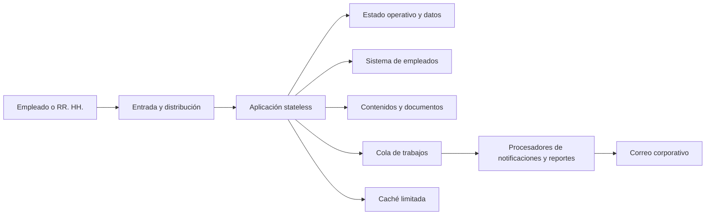

# Semana 7. Análisis de capacidad de SkillHub

## 1. Modelo inicial y recorrido de una solicitud

La **latencia** es el tiempo que tarda una operación individual en responder o completar. El **throughput** es la cantidad de trabajo completado por unidad de tiempo. La **concurrencia** es el número de operaciones activas al mismo tiempo. La **capacidad** es el máximo throughput sostenible bajo una carga y un objetivo de latencia y errores definidos.

Los valores de este documento son provisionales: parten de aproximadamente 1.000 empleados, hasta 100 cursos, una campaña cercana a 1.000 asignaciones/notificaciones y la hipótesis previa de hasta 50 usuarios simultáneos.

El recorrido no implica que todos los flujos usen todos los pasos. Catálogo usa principalmente lecturas de contenido; evaluación escribe estado operativo; notificaciones pasan por la cola. La entrada puede distribuir solicitudes entre instancias, pero eso no elimina los límites compartidos de datos, contenidos, sistema de empleados o correo.

## 2. Escenarios de carga y capacidad

| Escenario | Carga normal | Pico provisional | Latencia y throughput objetivo | Recurso limitante probable | Intervención propuesta y evidencia requerida |
|---|---|---|---|---|---|
| **Consulta del catálogo** | 1 solicitud/s sostenida; lecturas de cursos publicados y metadatos. Hipótesis derivada de unas 10.000 consultas interactivas semanales distribuidas. | 20 solicitudes/s durante el inicio de una campaña; hasta 50 usuarios simultáneos. Hipótesis. | p95 <= 2 s y error < 1%; sostener 20 solicitudes/s durante 10 minutos sin crecer la cola de solicitudes. | Lecturas repetidas del estado publicado, contenido y conexiones disponibles; si se abren muchos documentos, red o almacenamiento de contenidos. | **Primero:** optimizar consultas y usar caché-aside con TTL corto para catálogo publicado, invalidada al publicar/retirar. **Vertical:** ampliar capacidad del nodo si CPU, memoria o conexiones son el límite y el pico es moderado. **Stateless + balanceador:** aplicar si varias instancias reducen la cola y las sesiones no dependen de memoria local. **CDN:** no inicialmente; solo para contenido estático no sensible con control de acceso y TTL. Medir p95/p99, tasa de aciertos de caché, CPU, memoria, conexiones y tiempo de lectura. |
| **Revisión de contenidos y evaluación** | Decenas de instructores editan cursos; 0,2 envíos de progreso/evaluación por segundo como hipótesis, con lecturas de contenidos por parte de empleados. | 5 operaciones de evaluación/escritura por segundo y 20 usuarios simultáneos durante una campaña o fecha límite. Hipótesis. | p95 <= 3 s para guardar progreso o presentar evaluación; >= 5 operaciones/s sin superar límites de intentos ni duplicar resultados; error < 1%. | Contención en el estado transaccional, conexiones al almacén, tamaño de documentos o latencia de la dependencia de empleados al validar elegibilidad. | **Connection pooling:** dimensionar y limitar el pool; medir espera por conexión antes de aumentarlo. **Vertical:** primera opción para el estado transaccional si CPU, I/O o bloqueo son el límite. **Stateless:** permite añadir instancias para lecturas y solicitudes, con estado de negocio compartido y no en memoria local. **Horizontal + balanceador:** solo después de confirmar saturación de aplicación y que el almacén soporta el reparto. **No cachear** intentos, límite de intentos, autorización ni resultados privados. **Particionar:** no en el MVP; reconsiderar por curso/periodo si el volumen histórico o los bloqueos lo justifican. Medir p95/p99, bloqueos, uso de conexiones, I/O, errores de concurrencia y tiempo de la API de empleados. |
| **Envío de notificaciones** | Unos pocos eventos por minuto fuera de campañas; una notificación interna y un intento de correo por asignación, resultado o certificado. Hipótesis. | Hasta 1.000 eventos en 10 minutos, cerca de 1,7 mensajes/s, con ráfagas superiores si una campaña termina simultáneamente. | Confirmar el evento local en <= 2 s; procesar al menos 2 mensajes/s de forma sostenida como objetivo inicial. La entrega de correo puede ser eventual; la edad del mensaje no debería superar 15 min en condiciones normales. Hipótesis. | Límite de entrega del correo, consumidores de la cola o acumulación de reintentos; no debe bloquear la transacción de asignación o certificado. | **Cola:** absorber la ráfaga y separar la operación principal del correo. **Backpressure:** limitar productores, fijar capacidad máxima y mostrar pendientes si la cola envejece. **Horizontal:** aumentar consumidores solo si el proveedor acepta el ritmo; no sirve si el correo es el límite. **Idempotencia:** deduplicar por evento, destinatario, canal y tipo. **No CDN:** la notificación contiene datos personales; el correo y la bandeja requieren autorización. **Particionar:** considerar por campaña o prioridad solo si la cola única muestra espera excesiva. Medir edad máxima, profundidad, tasa de reintentos, tasa de entrega, tiempo del proveedor y mensajes no procesables. |

## 3. Primer cuello de botella probable

La hipótesis inicial es que el primer cuello de botella durante una campaña será la **capacidad de procesar y entregar notificaciones**, especialmente el límite del correo corporativo y la cola de reintentos. Una campaña de 1.000 empleados puede producir una ráfaga mucho mayor que el tráfico normal, mientras que la entrega externa no está bajo control de SkillHub. Si el sistema intenta enviar directamente dentro de la operación de asignación, el tiempo de respuesta y las conexiones quedarían ocupados por una dependencia lenta.

Este cuello de botella se comprobaría con una prueba representativa, no con una cifra asumida: producir una campaña de 1.000 eventos, medir profundidad y edad de la cola, tasa de entrega, latencia del correo, reintentos, uso de consumidores y efecto sobre asignaciones. Si la cola permanece estable y el proveedor acepta el ritmo, el límite no está allí y debe revisarse el siguiente recurso. Si la cola crece de forma sostenida, la capacidad efectiva del consumidor es menor que la tasa de producción y hay que reducir producción, ampliar consumidores cuando sea posible o aceptar mayor tiempo de entrega.

Existe un segundo riesgo que debe medirse: validar una población por área o rol puede generar muchas consultas síncronas al sistema corporativo de empleados. Si su latencia p95 o tasa de rechazo se degrada antes que la notificación, esa dependencia pasa a ser el cuello de botella real. No se debe resolver aumentando instancias de SkillHub si el proveedor externo es quien está saturado.

## 4. Política para absorber picos sin agotar recursos

1. **Separar trabajo interactivo y diferible:** activar la asignación o registrar el resultado no espera a que se envíe el correo; la notificación queda en cola.
2. **Limitar la producción mediante backpressure (contrapresión):** una campaña no puede insertar trabajo ilimitado; si la cola alcanza su umbral, se pausa la generación o se marca el resto como pendiente.
3. **Aplicar prioridades:** confirmaciones de certificados y resultados pueden preceder a recordatorios, sin saltarse la deduplicación.
4. **Limitar reintentos:** los fallos transitorios usan reintentos acotados; los mensajes inválidos pasan a estado no procesable para no consumir toda la capacidad.
5. **Hacer visible el retraso:** RR. HH. debe conocer eventos pendientes, edad máxima y tasa de fallo; una cola no puede ocultar una interrupción indefinida.
6. **Degradar solo lo secundario:** si falla correo, se conserva la bandeja interna y el estado de asignación o certificado; nunca se relajan autorización, límites de intentos o integridad de resultados.

La política convierte un pico de solicitudes inmediatas en trabajo pendiente controlado. No promete entrega instantánea, pero evita agotar memoria, conexiones o recursos de la operación principal.

## 5. Decisiones de escalabilidad y sus límites

### Vertical antes que horizontal

Para el MVP, el escalado vertical es la intervención inicial más simple para CPU, memoria, I/O o conexiones del estado operativo. Tiene menor costo de operación y conserva una coordinación sencilla. Se debe abandonar esta opción cuando el recurso llegue cerca de su límite sostenido, el mantenimiento produzca una interrupción inaceptable o el crecimiento supere la capacidad física o económica del nodo.

El escalado horizontal de la aplicación es razonable si las solicitudes son stateless y el estado se mantiene en dependencias compartidas. Requiere balanceador, salud de instancias y observación de errores; no debe aplicarse como respuesta automática si la base, la API de empleados o el correo siguen siendo únicos y saturados.

### Caché y CDN con datos privados

El catálogo de cursos publicados puede tolerar una caché corta porque un retraso breve en una portada no decide autorización ni finalización. La invalidación al publicar o retirar debe limitar la ventana de información obsoleta. No se debe cachear sin control el plan individual, progreso, intentos, resultados, certificados o estado activo del empleado.

Una CDN no es necesaria para el MVP y no debe servir documentos privados por defecto. Solo sería evaluable para contenido publicado que no exponga datos personales, con autorización, expiración e invalidación verificables. Los videos externos quedan fuera del control de SkillHub.

### Connection pooling y particionamiento

El pooling puede reducir el costo de abrir conexiones en catálogo y evaluación, pero el tamaño debe estar limitado por la capacidad real del almacén. Aumentar el pool sin medir solo mueve el cuello de botella al almacén y eleva la espera.

No se recomienda particionar ni hacer sharding inicialmente. La población y el volumen conocidos no lo justifican. Si el histórico de intentos, auditoría o reportes crece, particionar por periodo puede reducir el conjunto escaneado y simplificar retención; la métrica sería tiempo de consulta, I/O y tamaño del histórico. Sharding solo sería defendible con una carga que no pueda sostenerse con escalado vertical y particionamiento local.

## 6. Comparación con mantener una solución simple

Mantener una aplicación stateless con un almacén transaccional, caché limitada para catálogo y cola solo para notificaciones tiene menor costo, menos componentes y menor carga de operación. Es adecuado para las cifras conocidas y permite medir antes de introducir CDN, múltiples réplicas o particiones.

Añadir horizontalidad, CDN o particionamiento antes de confirmar los cuellos de botella aumenta costos, invalidaciones, observabilidad y escenarios de fallo. La cola de notificaciones sí tiene una justificación temprana porque protege una operación crítica frente a un proveedor lento y absorbe un pico conocido. El riesgo aceptado es que una notificación pueda retrasarse; el riesgo evitado es bloquear o duplicar asignaciones y certificados.

La regla de evolución es: aplicar primero la intervención que reduzca el recurso medido, repetir la misma carga representativa y conservarla solo si mejora p95, throughput, errores o edad de cola sin superar el presupuesto operativo.

## 7. Supuestos y preguntas pendientes

1. ¿Cuántos usuarios simultáneos habrá realmente durante una campaña, y se acercan al supuesto de 50 o lo superan ampliamente?
2. ¿Cuántas campañas ocurren por periodo, cuántas asignaciones generan y en qué ventana temporal se concentran las notificaciones y evaluaciones?
3. ¿Cuál es el tamaño promedio y máximo de documentos y contenidos, y qué proporción se consulta simultáneamente durante una campaña?
4. ¿Qué límites de tasa, latencia y reintentos aplica el sistema corporativo de empleados y el correo corporativo?